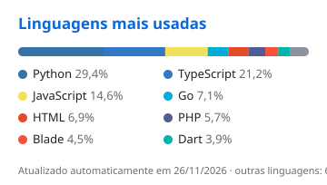

<h1 align="center">Olá, eu sou o Moab Lima 👋</h1>

  <b>Desenvolvedor Full Stack</b> · Web, back-end, apps e ferramentas de linha de comando

  
  

---

### 🧑‍💻 Sobre mim

- 🔭 Construo sistemas web completos: controle de estoque, ponto eletrônico, finanças pessoais e painéis administrativos
- ⚙️ Gosto de criar ferramentas próprias, como CLIs em Go e automações em Python
- 🎮 Também desenvolvo jogos com Godot
- 🌱 Continuo aprendendo sobre back-end, desenvolvimento móvel e infraestrutura

---

### 🛠️ Tech Stack

**Linguagens**

  
  
  
  
  
  
  

**Front-end**

  
  
  
  
  

**Back-end, aplicativos móveis e jogos**

  
  
  
  
  

**Bancos de dados**

  
  
  

---

### 🧰 Tools

  
  
  
  
  
  
  

---

### 🚀 Principais projetos

| Projeto | Descrição | Stack |
|---|---|---|
| [**ytconv**](https://github.com/M0abl1/youtube_converter) | Baixe vídeos, áudios e playlists inteiras do YouTube pelo terminal ou por uma interface web local. Binário único em Go no desktop e app Android. | Go · JavaScript (interface web) · Kotlin (Android) |
| [**Sistema de Almoxarifado**](https://github.com/M0abl1/sistema-almoxarifado) | Controle de estoque, patrimônio e movimentações com relatórios para impressão. | JavaScript · Tailwind CSS · Firebase |
| [**Controle Financeiro**](https://github.com/M0abl1/controle-financeiro) | PWA de finanças pessoais com distribuição da renda, metas, reserva e carteira de investimentos. | TypeScript · React · Firebase · PWA |
| [**Sistema de Ponto**](https://github.com/M0abl1/ponto-eletronico) | Controle de ponto eletrônico com área administrativa e gestão de colaboradores. | JavaScript · HTML · Tailwind CSS · Firebase |
| [**Project Infinity Panel**](https://github.com/M0abl1/painel-minecraft) | Painel de administração de servidor Minecraft com acesso restrito via Tailscale. | Python · FastAPI · SQLite |
| [**Jogo do Folclore**](https://github.com/M0abl1/jogo-do-folclore) | Jogo com temática do folclore brasileiro. | Godot · GDScript |
| [**M0abl1.dev**](https://github.com/M0abl1/M0abl1.dev) | Site pessoal para exibir meu currículo. | Laravel · PHP · Docker |

---

### 📊 Linguagens mais usadas

🏆 Linguagem mais usada: <!--TOP_LANG:START-->**Python** (28,1%)<!--TOP_LANG:END-->

  <picture>
    <source media="(prefers-color-scheme: dark)" srcset="./assets/top-langs-dark.svg"/>
    <source media="(prefers-color-scheme: light)" srcset="./assets/top-langs-light.svg"/>
    
  </picture>

Calculado a partir dos meus repositórios públicos e atualizado todos os dias por uma GitHub Action.

---

### 📫 Contato

  

